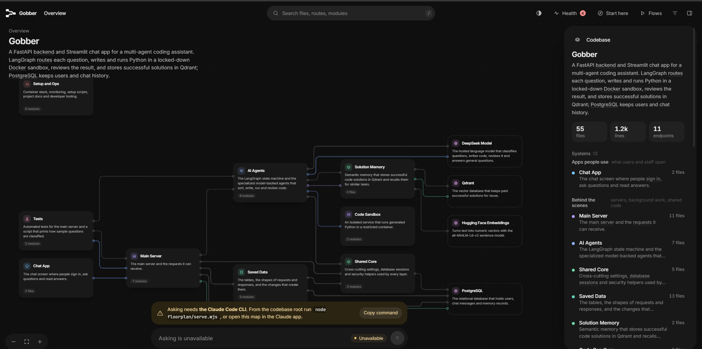

# dsh-floorplan-adapter

A [DeepSeek Harness](https://github.com/deepseek-ai/DeepSeek-Harness) (`dsh`) plugin that I built to connect the open-source [Floorplan](https://github.com/haydenschmitty/floorplan) codebase mapper to DeepSeek, as an open-source alternative to Claude Code and Codex. I used my own multi-agent project, "Gobber" (a FastAPI + Python AI system), as the testbed for this adapter.



## Overview

I designed this plugin as a bridge between two tools. It provides the "mechanical hands" by running Floorplan's Node.js scripts, while DeepSeek acts as the "brain" by reading the code and writing the architecture descriptions.

## How it works

The pipeline runs in four steps:

1. **Scan:** The plugin extracts the project's files and routes.
2. **Architect:** DeepSeek reads the scan and writes `floorplan/architecture.json`.
3. **Build:** The plugin generates the initial map.
4. **Describe:** The plugin generates worksheets. DeepSeek reads them, writes descriptions to `floorplan/descriptions/`, and triggers the final build.

## Tools

I register three tools in `dsh`:

| Tool | Description |
|------|-------------|
| `floorplan_scan` | Runs `scan.mjs` and returns a summary of the project's files and HTTP routes. |
| `floorplan_build` | Runs `build.mjs` to generate the interactive `index.html` map. |
| `floorplan_describe` | Runs `describe.mjs` to generate worksheets, so DeepSeek can write human-readable descriptions for every file and route. |

## Requirements

- Node.js 20+
- `pnpm` (used by `dsh plugin add`)
- A DeepSeek API key (`DEEPSEEK_API_KEY`)
- [Floorplan](https://github.com/haydenschmitty/floorplan) cloned locally at `~/floorplan`

## Installation

```bash
# Install dependencies and build the plugin
npm install
npm run build

# Register the plugin with dsh
npx @deepseek-ai/dsh plugin --profile headless add "$(pwd)"

# Set your API key
export DEEPSEEK_API_KEY="sk-..."
```

## Usage

I include a wrapper script that reduces terminal noise, shows a live progress bar, and saves a full log file:

```bash
./scripts/dsh-progress.sh ~/path/to/your/project \
  "Use floorplan_scan on ~/path/to/your/project. Follow the instructions in the tool result."
```

### Output

- **Progress bar:** shows live progress from 5% to 100%.
- **Logs:** full reasoning and diagnostics are saved to `<project>/floorplan/.cache/adapter.log`.
- **Answer:** the clean final output is saved to `<project>/floorplan/.cache/answer.txt`.

## Project Layout

```
├── docs/
│   └── screenshot.png                # Example of the generated map
├── src/
│   ├── index.ts                      # Registers the three tools
│   ├── floorplan-runner.ts           # Runs Floorplan's scripts as subprocesses
│   └── progress.ts                   # Writes progress markers for the wrapper script
└── scripts/
    ├── dsh-progress.sh               # Wrapper script for progress bars and logging
    └── copy-floorplan-to-gobber.sh   # Copies the generated map into a read-only project
```

## Important Notes

- **Sandbox read-only restrictions:** If the target project is read-only, run the provided `copy-floorplan-to-gobber.sh` script from a shell with write access to copy the generated map into the project folder.
- **Version alignment:** Make sure your `@deepseek-ai/*` packages match the version of `dsh` you are running, to avoid `ERR_MODULE_NOT_FOUND` errors or schema mismatches.

## License

MIT

## Credits

- Built on top of [Floorplan](https://github.com/haydenschmitty/floorplan) by [haydenschmitty (Hayden)](https://github.com/haydenschmitty).
- Powered by [DeepSeek Harness](https://github.com/deepseek-ai/DeepSeek-Harness).
